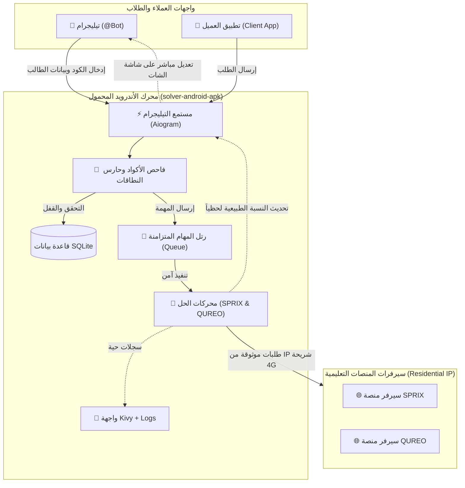

# 🎓 Solver Project Suite — Master Workspace

مجموعة مشاريع ومنظومة برمجية متكاملة لأتمتة حل واجبات واختبارات المنصات التعليمية (`SPRIX`, `QUREO`, `QUREO2`) بالعلامة الكاملة (100% / PERFECT) بدون أخطاء، مع توفير واجهات تحكم سحابية وتطبيقات أندرويد وبوت تيليجرام تفاعلي متقدم.

---

## 🗂️ خريطة المشاريع المستقلة (Project Catalog)

تم تقسيم المنظومة إلى مشاريع فرعية متخصصة ومستقلة، لكل منها مستودع Git خاص بها وملف إرشادات شامل:

| المجلد / المشروع | النوع والتقنية | الوصف والدور | التوثيق |
| :--- | :--- | :--- | :--- |
| **[`solver-android-apk/`](solver-android-apk/)** | Python / Kivy / Buildozer | **المشروع الأساسي الموصى به**: تطبيق أندرويد يعمل كـ Residential Mobile IP Relay لمنع حظر 403، ويشغّل بوت التيليجرام ومحركات الحل محلياً | [دليل APK](solver-android-apk/README.md) |
| **[`telegram-bot/`](telegram-bot/)** | Python / Aiogram 3 / Gradio | بوت تيليجرام مستقل ومصمم للعمل على سيرفرات سحابية (Hugging Face Spaces / VPS) لإدارة الأكواد والعملاء | [دليل البوت](telegram-bot/README.md) |
| **[`qureo-solver/`](qureo-solver/)** | Bash / curl / Python | سكربت طرفية (CLI) فائق السرعة لحل منهاج **QUREO JavaScript** (54 فصلاً - 270 ماسة) | [دليل Qureo](qureo-solver/README.md) |
| **[`qureo2-solver/`](qureo2-solver/)** | Bash / curl / Python | سكربت طرفية (CLI) فائق السرعة لحل منهاج **QUREO2 Python** (25 فصلاً - 125 ماسة) | [دليل Qureo2](qureo2-solver/README.md) |
| **[`sprix-solver/`](sprix-solver/)** | Bash / curl / Python | محرك حل مادة الثقافة المالية **SPRIX** (الوحدات 19–24) مع أدوات المعالجة الدفعية للمدارس | [دليل Sprix](sprix-solver/README.md) |
| **[`solver-app/`](solver-app/)** | Native Android / Kotlin | تطبيق أندرويد نيتف أصلي بواجهات كوتلن ونظام بناء Gradle | [دليل Kotlin App](solver-app/README.md) |
| **[`client-solver-app/`](client-solver-app/)** | Native Android / Kotlin | تطبيق العميل التجريبي على أندرويد للاتصال وإدخال الأكواد | [دليل Client App](client-solver-app/README.md) |
| **[`docs/`](docs/)** | Markdown / Data | المخططات الهندسية، وثائق بنية النظام، دليل الـ Relay، والخطة التشغيلية للـ SaaS | [دليل الوثائق](docs/README.md) |
| **[`releases/`](releases/)** | APK / Zip | حزم الـ APK المترجمة الجاهزة للتثبيت الفوري على الهاتف أو المحاكي | [دليل الحزم](releases/README.md) |

---

## 🏛️ الهيكل المعماري لمنظومة الحل (System Architecture)



---

## 🚀 البدء السريع (Quick Start)

### 1. لتشغيل منظومة الأندرويد والبوت (الحل الموصى به):
```bash
cd solver-android-apk
python3 build_local_apk.py
adb install -r bin/solverbot-1.0.0-arm64-v8a-debug.apk
```
أو قم بتثبيت النسخة المجمعة مسبقاً مباشرة من مجلد `releases/`:
```bash
adb install -r releases/SolverBot.apk
```

### 2. لتشغيل حل سريع عبر الطرفية (CLI):
```bash
# لحل مادة الثقافة المالية SPRIX:
cd sprix-solver && ./solve.sh <LOGIN_ID> <PASSWORD>

# لحل مادة QUREO جافاسكريبت:
cd qureo-solver && ./solve.sh <STUDENT_ID> <PASSWORD>

# لحل مادة QUREO2 بايثون:
cd qureo2-solver && ./solve.sh <STUDENT_ID> <PASSWORD>
```
