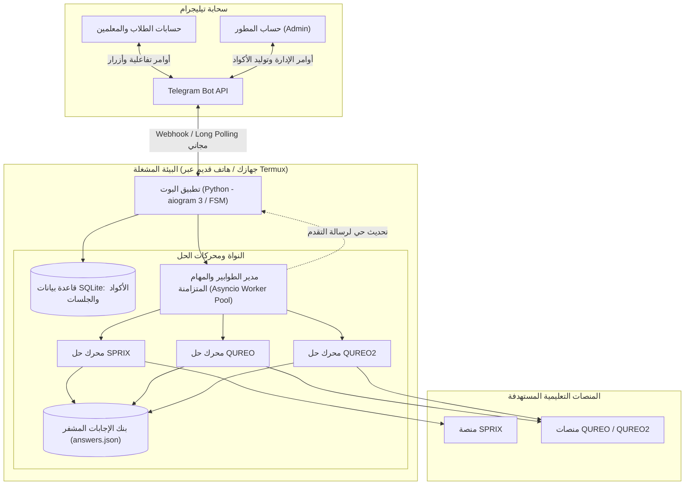

# خطة معمارية شاملة: تحويل مشروع Solver إلى Telegram Bot SaaS (بتكلفة صفرية)

---

## 1. الرؤية العامة (Executive Vision)

تحويل منظومة الحل الذكية (`SPRIX` / `QUREO` / `QUREO2`) إلى **خدمة سحابية تفاعلية بالكامل عبر بوت تيليجرام (Telegram Bot SaaS)**:
- **التكلفة الإجمالية**: **0.00 جنيه / 0.00 دولار للأبد** (بدون VPS وبدون أي بطاقات بنكية).
- **حماية بنك الإجابات 100%**: بقاء ملفات `answers.json` ومنطق الاتصال البرمجي داخل الخادم الخاص بك فقط دون أن يراها أو يحملها أي مستخدم.
- **السهولة والانتشار**: تيليجرام مثبت بالفعل لدى جميع الطلاب والمدرسين، ولا يتطلب تنزيل أي APK، ويعمل بسلاسة على كل الأجهزة (أندرويد، آيفون، كمبيوتر).
- **التوافق ضد الحظر**: الاتصال يخرج من إنترنت منزلي طبيعي (Residential IP) مما يحمي عمليات الحل من اكتشاف الـ Bots وحظر السيرفرات السحابية.

---

## 2. معمارية النظام (System Architecture)



---

## 3. محرك الأكواد والتراخيص الديناميكية (Dynamic Voucher Engine)

النظام سيعتمد على قاعدة بيانات محلية خفيفة وسريعة جداً (**SQLite**)، تخزن وتتحقق من الأكواد:

### أ. أنواع الأكواد وصلاحياتها:
1. **كود تجربة / فصول محددة (Partial Scope)**:
   - مثال: يفتح فصلاً واحداً فقط (فصل 1)، أو نطاقاً محدداً (مثلاً فصول 1 إلى 3).
   - الاستخدام: لإثبات الفاعلية للطالب قبل الدفع، أو لمن رسب في فصول معينة فقط.
2. **كود مادة كاملة (Full Platform Scope)**:
   - يفتح كورس الثقافة المالية كاملاً (الوحدات 19–24) أو كورس البرمجة كاملاً (54 فصلاً).
3. **كود باقة المدرسين / الدفعات (Bulk Batch Scope)**:
   - يتيح للمدرس رفع ملف إكسيل أو نصي به قائمة طلاب (مثل دفعة الـ 47 طالباً)، ويقوم البوت بحلهم واحداً تلو الآخر مع تقرير شامل بالنتائج.

### ب. شروط وقفل الأكواد:
- كل كود له عدد استخدامات محدد (افتراضياً استخدام واحد `max_uses=1`).
- بمجرد استخدام الكود لحساب منصة، يتم ربط الكود برقم الطالب (`student_id`) لمنع إعطائه لزميله.

---

## 4. تجربة المستخدم التفاعلية (User Flow)

1. **بدء المحادثة**:
   - الطالب يضغط `/start`، فيرحب به البوت برسالة أنيقة بأزرار تفاعلية (Inline Keyboards):
     - 🎓 حل مادة SPRIX (ثقافة مالية)
     - 💻 حل مادة QUREO (جافاسكريبت)
     - 🐍 حل مادة QUREO2 (بايثون)
     - 🔑 إدخال / فحص كود التفعيل
     - 📞 تواصل مع الدعم / شراء كود

2. **خطوات الحل (FSM - Finite State Machine)**:
   - يطلب البوت: *"أدخل كود التفعيل الخاص بك"* ⬅️ يتحقق البوت فورياً من الكود ويعرض صلاحيته: *(كود صالح: حل مادة SPRIX كاملة)*.
   - يطلب البوت: *"أدخل كود الطالب (Login ID)"*.
   - يطلب البوت: *"أدخل كلمة المرور"*.
   - يعرض البوت رسالة تأكيد مع زر `[ 🚀 بدء الحل الآن ]`.

3. **شاشة اللوج والتقدم الحي (Live Progress Message)**:
   - بدلاً من إرسال مئات الرسائل المزعجة، يقوم البوت **بتعديل نفس الرسالة (Message Edit)** في تيليجرام كل عدة ثوانٍ لعرض شريط تقدم حي احترافي:
     ```text
     🔄 جاري حل الحساب: 472713104 (SPRIX)
     ━━━━━━━━━━━━━━━━━━━━ 65%
     📍 المرحلة الحالية: الوحدة 21 - اختبار 41
     ⭐ النتيجة: 5 نجوم (درجة 100/100)
     ⚡ السرعة: نمط التسريع الذكي نشط
     ⏳ الوقت المتوقع للانتهاء: دقيقتان
     ```
   - عند الانتهاء:
     ```text
     ✅ تم الانتهاء بنجاح 100%!
     🎉 جميع الوحدات 19–24 اكتملت بالعلامة الكاملة.
     ```

---

## 5. لوحة تحكم الإدارة داخل التيليجرام (Admin Bot Commands)

أنت (المسؤول) تتحكم في المنصة بالكامل من هاتفك عبر شات خاص مع البوت:

* **توليد الأكواد**:
  - `/gen sprix full` ⬅️ يولد كود حل منصة كاملة فوري جاهز للنسخ.
  - `/gen qureo 1-2` ⬅️ يولد كود مخصص للفصل 1 و 2 فقط.
  - `/gen batch 50` ⬅️ يولد كود باقة لـ 50 طالباً.
* **المراقبة والإحصائيات**:
  - `/stats` ⬅️ يعرض: عدد الأكواد الصادرة، الأكواد المستهلكة، عدد الطلاب الذين تم حلهم اليوم، والمهام الجارية حالياً في الطابور.
  - `/queue` ⬅️ عرض الطلاب في قائمة الانتظار الحالية.
* **التحكم بالتشغيل**:
  - `/stop [task_id]` ⬅️ إيقاف عملية حل جارية فوراً.
  - `/broadcast` ⬅️ إرسال رسالة تنبيهية لجميع مستخدمي البوت.

---

## 6. خيارات التشغيل والاستضافة (تكلفة 0 للأبد)

1. **الخيار الأول (جهازك الشخصي)**:
   - تشغيل البوت عبر أمر `python bot.py` وقتما تكون متواجداً على جهازك.
   - يستقبل الأوامر ويحل للطلاب بسرعة فائقة.

2. **الخيار الثاني (موبايل أندرويد قديم شغال 24/7 عبر Termux)**:
   - إذا كان لديك أي هاتف أندرويد قديم لا تستخدمه، يمكنك تثبيت تطبيق **Termux** وتشغيل البوت عليه وهو متصل بشاحن وواي فاي المنزل.
   - يعمل البوت 24 ساعة يومياً بدون انقطاع وبدون استهلاك كهرباء الكمبيوتر وبدون دفع فلس واحد!

3. **الخيار الثالث (استضافة سحابية مجانية 100% مثل Koyeb أو Render)**:
   - رفع كود البوت كـ Worker مجاني.

---

## 7. خطة التنفيذ المرحلية (Roadmap)

### المرحلة الأولى: تجريد محركات الحل (Core Wrappers)
- إنشاء ملفات وسيطة خفيفة بلغة بايثون تستورد محركات الحل (`qureo-solver` و `sprix-solver`) وترجع بيانات التقدم عبر دوال (Callbacks) متوافقة مع الـ Async.

### المرحلة الثانية: بناء قاعدة بيانات الأكواد (Voucher & Database Module)
- بناء سكيما SQLite للأكواد وسجل العمليات مع دوال توليد والتحقق من صلاحية الأكواد.

### المرحلة الثالثة: هيكل بوت التيليجرام ونظام الحالات (aiogram 3 FSM)
- بناء شاشات الترحيب، أزرار الاختيار، معالجة إدخال الحسابات، والحماية من الأخطاء والإدخال الخاطئ.

### المرحلة الرابعة: شاشة التقدم الحي ونظام الطابور (Worker Queue & Live UI)
- بناء نظام التحديث اللحظي لرسالة التيليجرام وشريط التقدم المئوي مع التعامل مع أقصى حدود الرسائل (Telegram Rate Limits).

### المرحلة الخامسة: لوحة أوامر الأدمن والتجربة النهائية
- برمجة أوامر المسؤول السرية واختبار المنظومة من البداية للنهاية على حسابات تجريبية حقيقية.
