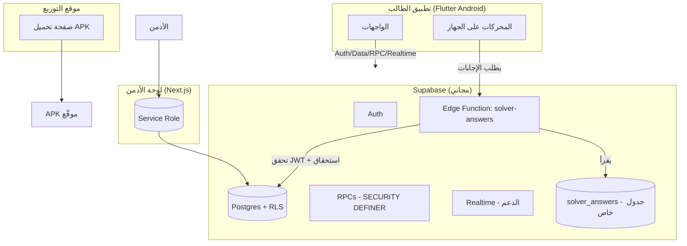

# 🎓 Solver Platform — دليل المشروع الشامل

> **هذا الملف هو نقطة البداية لأي شخص أو Agent يشتغل على المشروع.**
> اقرأه بالكامل قبل أي تعديل، مع:
> - `PLAN.md` — الرؤية والقرارات المعمارية.
> - `SECURITY_AUDIT.md` — نتائج المراجعة الأمنية.
> - `SETUP_AFTER_SECURITY_FIX.md` — خطوات التشغيل بعد إصلاحات الأمان.

---

## 📑 الفهرس

1. [إيه هو المشروع](#1-إيه-هو-المشروع)
2. [المخطط المعماري](#2-المخطط-المعماري)
3. [هيكل المجلدات](#3-هيكل-المجلدات)
4. [المفاهيم الأساسية](#4-المفاهيم-الأساسية)
5. [⭐ كيف تعمل الإجابات (أهم قسم)](#5--كيف-تعمل-الإجابات-أهم-قسم)
6. [🔄 سيناريوهات شائعة (لو حصل X اعمل Y)](#6--سيناريوهات-شائعة)
7. [قاعدة البيانات (الجداول والدوال)](#7-قاعدة-البيانات)
8. [الترحيلات (Migrations)](#8-الترحيلات-migrations)
9. [Edge Functions](#9-edge-functions)
10. [تطبيق الموبايل (Flutter)](#10-تطبيق-الموبايل-flutter)
11. [لوحة الأدمن (Next.js)](#11-لوحة-الأدمن-nextjs)
12. [الموقع والتوزيع](#12-الموقع-والتوزيع)
13. [البناء والإصدار](#13-البناء-والإصدار)
14. [المتغيرات والأسرار](#14-المتغيرات-و-الأسرار)
15. [الأمان — قواعد لا تُخالَف](#15-الأمان--قواعد-لا-تُخالَف)
16. [استكشاف الأخطاء](#16-استكشاف-الأخطاء)
17. [خريطة "عايز أعدّل X → روح للملف Y"](#17-خريطة-التعديلات-السريعة)

---

## 1) إيه هو المشروع

منصة تعليمية فيها:

- **تطبيق أندرويد (Flutter):** الطالب يسجّل بحساب Google، يختار مرحلته/مساره/لغته، يشحن عملات، ويفتح منصات تعليمية ويحلّها تلقائيًا **على جهازه** (IP المشترك بتاعه = تقليل حظر المنصات).
- **قاعدة بيانات + خدمات (Supabase):** المصادقة، الملفات الشخصية، المحفظة، الاستحقاقات، شات الدعم، و**بنك الإجابات**.
- **لوحة أدمن (Next.js):** إدارة الطلاب، الشحن اليدوي، الأسعار، التجارب، صندوق الدعم، سجل التدقيق.
- **موقع توزيع (Static):** صفحة تحميل الـ APK.

**المحركات الستة المدعومة:**

| الكود | المنصة | اللغة | عدد الفصول | `chapter_base` |
|---|---|---|---|---|
| `qureo` | QUREO JavaScript | عربي | 54 | 90000 |
| `qureo_js_en` | QUREO JavaScript | إنجليزي | 54 | 30000 |
| `qureo2` | QUREO2 Python | عربي | 25 | 511000 |
| `qureo2_en` | QUREO2 Python | إنجليزي | 10 | 531000 |
| `sprix` | SPRIX (الثقافة المالية) | عربي | 6 وحدات | — |
| `sprix_en` | SPRIX (Financial Literacy) | إنجليزي | 6 وحدات | — |

> **ملاحظة:** `chapter_base` = الفرق بين رقم الفصل الطبيعي (1..N) ورقم الفصل الخام على المنصة (مثال: الفصل 1 في `qureo` = `90001`).

---

## 2) المخطط المعماري



**قاعدة ذهبية:** الإجابات **لا تُشحن داخل التطبيق أبدًا**. التطبيق يطلبها من `solver-answers` بعد التحقق من الجلسة والموافقة والحساب المربوط والاشتراك.

---

## 3) هيكل المجلدات

```
solver-project/                     ← جذر الـ workspace
├── Engines/                        ← ⭐ المصدر الأصلي لملفات الإجابات
│   ├── qureo-solver/answers.json
│   ├── qureo-js-en-solver/answers.json
│   ├── qureo2-solver/answers.json
│   ├── qureo2-en-solver/answers.json
│   ├── sprix-solver/answers.json
│   └── sprix-en-solver/answers.json
│
└── solver-platform/                ← المنصة (V1)
    ├── README.md                   ← (هذا الملف)
    ├── PLAN.md                     ← الرؤية والقرارات
    ├── SECURITY_AUDIT.md           ← المراجعة الأمنية
    ├── SETUP_AFTER_SECURITY_FIX.md ← خطوات التشغيل بعد الإصلاحات
    ├── RELEASE_GUIDE.md            ← دليل الإصدار المفصّل
    │
    ├── supabase/
    │   ├── config.toml
    │   ├── migrations/             ← 00001 → 00009
    │   ├── functions/
    │   │   └── solver-answers/     ← Edge Function توزيع الإجابات
    │   └── scripts/
    │       ├── upload_answers.py   ← ⭐ رفع الإجابات للسيرفر
    │       └── promote_admin.sql   ← ترقية حساب لأدمن
    │
    ├── app/                        ← تطبيق Flutter
    │   ├── lib/
    │   │   ├── core/               ← constants, router, theme, errors
    │   │   ├── models/             ← Profile, Engine, Entitlement, ...
    │   │   ├── services/           ← answers, auth, engine, wallet, support
    │   │   ├── providers/          ← Riverpod providers
    │   │   ├── screens/            ← الشاشات
    │   │   ├── solver/             ← محركات الحل (qureo, sprix, pace, api)
    │   │   └── widgets/
    │   ├── android/                ← إعدادات أندرويد + التوقيع
    │   ├── assets/                 ← logo + fonts (لا إجابات!)
    │   └── tool/                   ← generate_release_keystore.sh
    │
    ├── dashboard/                  ← لوحة الأدمن Next.js
    │   └── src/
    │       ├── app/                ← الصفحات + api/admin/*
    │       ├── components/
    │       └── lib/supabase/       ← client / server / middleware
    │
    └── WebSiteForApp/              ← موقع التحميل (Static)
        ├── index.html
        └── downloads/Solver-Platform.apk
```

---

## 4) المفاهيم الأساسية

### التسلسل الأكاديمي (determined عند التسجيل ومقفول)

| الصف | المسار | المحركات المتاحة |
|---|---|---|
| `grade_1` (أولى ثانوي) | — | `qureo` (أو `qureo_js_en` للغات) — حتى 42 فصل |
| `grade_2` + `engineering` | الهندسة وعلوم الحاسب | `sprix` + `qureo` + `qureo2` (حسب اللغة) |
| `grade_2` + باقي المسارات | طب/أعمال/فنون | `sprix` فقط |

### العملات والاشتراك

- **الفتح = كامل المنصة** (`scope='full'`) — مفيش بيع فصول بعد الآن.
- **التجربة المجانية مرة واحدة للعمر**، وعدد فصولها من إعدادات اللوحة:
  - `trial_chapters_grade1`
  - `trial_chapters_grade2_engineering`
  - `trial_chapters_grade2_other`
- الشحن **يدوي** عبر شات الدعم ← الأدمن يعتمد ويعدّل الرصيد.

### ربط حساب المنصة (Account Binding)

- الطالب يربط **كود دخول واحد** ببروفايله أول مرة يحل.
- كل استحقاق بيُختم (`platform_login_norm`) بالحساب المربوط عشان محدش يعيد استخدام شراء على حساب تاني.
- فك الربط من التطبيق أو من اللوحة (الأدمن).

### الموافقة على الحساب

- كل حساب جديد `approved = FALSE` لحد ما الأدمن يوافق من اللوحة.
- غير الطلاب (admin/merchant) يعتبرون موافَق عليهم دائمًا.

### حساب التاجر (Merchant)

- تبدأ كل الحسابات **طالبًا**؛ التاجر يُرقّى يدويًا من اللوحة (`admin_set_role`).
- عند الترقية: `role='merchant'` + كل المحركات الستة + `approved=TRUE`.
- **بدون تجربة مجانية** و**بدون إحالة**، وبـ**نفس أسعار الطالب** (الخصم يدوي وقت الشحن).
- بنفس نظام ربط حساب المنصة وختم الاستحقاقات مثل الطالب تمامًا.

---

## 5) ⭐ كيف تعمل الإجابات (أهم قسم)

### المسار الكامل

```
Engines/<engine>/answers.json
        │  (1) upload_answers.py   [مرة واحدة أو عند أي تغيير]
        ▼
Supabase: جدول solver_answers (خاص، RLS بلا سياسات)
        │  (2) Edge Function: solver-answers   [تتحقق من الاشتراك]
        ▼
التطبيق: AnswersService (يطلب لحظة الحل)
        │  (3)
        ▼
المحرك يحل الفصول
```

### 1. المصدر (Source of truth)

| كود المحرك | ملف الإجابات |
|---|---|
| `qureo` | `Engines/qureo-solver/answers.json` |
| `qureo_js_en` | `Engines/qureo-js-en-solver/answers.json` |
| `qureo2` | `Engines/qureo2-solver/answers.json` |
| `qureo2_en` | `Engines/qureo2-en-solver/answers.json` |
| `sprix` | `Engines/sprix-solver/answers.json` |
| `sprix_en` | `Engines/sprix-en-solver/answers.json` |

#### بنية ملف QUREO (`qureo`, `qureo_js_en`, `qureo2`, `qureo2_en`)

```json
{
  "90001": {
    "type": "review",
    "questions": [
      { "qid": 90001010, "qtype": "choice",      "choice_id": 900010101 },
      { "qid": 90001020, "qtype": "description",  "answer_code": "console.log(\"Good morning\");" }
    ]
  }
}
```

- المفتاح = **رقم الفصل الخام** (`chapter_base + natural`).
- `qtype`: إما `choice` (يحتاج `choice_id`) أو `description` (يحتاج `answer_code`).

#### بنية ملف SPRIX (`sprix`, `sprix_en`)

```json
{
  "chapters": { "100": [[10260, 3665], [10274, 3671]] },
  "tests":    { "23":  [[51201, 88001], [51202, 88007]] }
}
```

- كل عنصر = `[blockId/questionId, optionId]`.
- سكربت الرفع بيضيف تلقائيًا `chapter_order` (ترتيب الفصول) لتمكين فلترة التجربة.

### 2. الرفع للسيرفر

```bash
export SUPABASE_URL="https://<project>.supabase.co"
export SUPABASE_SERVICE_ROLE_KEY="<service-role-key>"
python3 solver-platform/supabase/scripts/upload_answers.py
```

- السكربت يقرأ كل الملفات، ويضيف `chapter_order` لـ SPRIX، ويرفعها بـ **upsert** (يستبدل الموجود).
- **لا يحتاج إعادة بناء التطبيق** بعد الرفع — التطبيق يقرأ مباشرة.

### 3. التحقق في السيرفر (Edge Function)

الـ `solver-answers` بيترفض الطلب (403) لو:
- مفيش JWT صالح.
- الحساب لسه `approved = false`.
- مفيش استحقاق (`entitlement`) لهذا المحرك أو الحساب المربوط مش مطابق.

وبعدها يرجّع **الإجابات المسموح بها فقط** (`scope='full'` → كل الفصول، `chapter` → الفصول المسموحة).

### 4. التقاطها في التطبيق

`app/lib/services/answers_service.dart`:

```dart
final response = await _client.functions.invoke(
  'solver-answers',
  body: {'engine_code': engineCode},
);
```

ثم `getQureo()` / `getSprixChapters()` / `getSprixTests()` تحوّلها لنماذج المحرك.

---

## 6) 🔄 سيناريوهات شائعة

### 🟢 أ) **الإجابات اتغيرت** (تصحيح إجابة / إضافة فصل موجود)

> **الأكثر شيوعًا — لا يحتاج إعادة بناء التطبيق.**

1. عدّل ملف الإجابات المناسب في `Engines/<engine>/answers.json`.
2. تأكد أن الـ JSON صالح:
   ```bash
   python3 -m json.tool Engines/qureo-solver/answers.json > /dev/null && echo OK
   ```
3. ارفع الملفات للسيرفر:
   ```bash
   export SUPABASE_URL="https://<project>.supabase.co"
   export SUPABASE_SERVICE_ROLE_KEY="<service-role-key>"
   python3 solver-platform/supabase/scripts/upload_answers.py
   ```
4. خلاص. أي طالب يفتح التطبيق ويحل هياخد النسخة الجديدة فورًا.

> لو الفصل الجديد **خارج** `max_chapter` الحالي → حدّثه:
> ```sql
> update engines set max_chapter = 55 where code = 'qureo';
> ```

### 🟢 ب) **تعديل سعر فتح منصة**

من لوحة الأدمن: `Pricing` → عدّل `cost` لـ `kind='full'`. (يبقى فوري في التطبيق)

> أو SQL: `update pricing set cost = 600 where engine_code='qureo' and kind='full';`

### 🟢 ج) **تعديل عدد فصول التجربة المجانية**

من لوحة الأدمن: `Settings` → عدّل:
`trial_chapters_grade1` / `trial_chapters_grade2_engineering` / `trial_chapters_grade2_other`.

### 🟢 د) **إضافة باقة عملات (Product)**

من لوحة الأدمن: `Products` → Add (name, coins, price).

### 🟢 هـ) **شحن رصيد طالب / منح استحقاق**

من لوحة الأدمن: `Users` → اختر الطالب → **شحن عملات** أو **منح فتح منصة**.
(كل عملية تُسجّل في `wallet_transactions` و`audit_logs`)

### 🟢 و) **فك ربط حساب طالب**

من لوحة الأدمن: `Users` → الطالب → **فك الربط**.
(الاستحقاقات تبقى مختومة بحسابها القديم ولا يُعاد استخدامها)

### 🟢 ز) **ترقية حساب إلى أدمن**

افتح `supabase/scripts/promote_admin.sql`، عدّل الإيميل، ونفّذه في SQL Editor.
> للهواتف: الإيميل = `user_<digits>@solver.app`

### 🔴 ح) **إضافة محرك جديد بالكامل**

1. **ملف الإجابات:** `Engines/<new-folder>/answers.json`.
2. **سكربت الرفع:** ضيف السطر في `SOURCES` داخل `supabase/scripts/upload_answers.py`.
3. **قاعدة البيانات:**
   ```sql
   insert into engines (code, name_ar, name_en, platform, course, language, max_chapter, chapter_base)
   values ('newe', 'اسم', 'Name', 'qureo', 'course_x', 'ar', 20, 600000);
   insert into pricing (engine_code, kind, cost) values ('newe','full',300);
   ```
4. **التطبيق:**
   - `app/lib/core/constants.dart`: أضف الكود + الاسم + الأيقونة + منطق `enginesForStudent`.
   - `app/lib/solver/qureo_solver.dart`: أضف `QureoCourse` الجديد في `of()` (لو QUREO).
   - `app/lib/screens/engine/solving_screen.dart`: أضف التوجيه للمحرك.
   - `app/lib/models/trial_info.dart`: أضف منطق التجربة إن لزم.
5. **ارفع الإجابات**، ثم **أعد بناء الـ APK** وأصدر نسخة.

### 🔵 ط) **إضافة فصول لمنهج (داخل نفس النطاق)**

نفس سيناريو (أ)، ولو النطاق اتوسّع عدّل `max_chapter`.

### 🟢 ي) **ترقية حساب إلى تاجر**

من لوحة الأدمن: `Users` → اختر المستخدم → **ترقية لتاجر**.
(أو SQL: `select admin_set_role('<user-id>', 'merchant');` بجلسة أدمن)

- يمنحه كل المحركات الستة + يفعّله تلقائيًا + بدون تجربة وبدون إحالة.
- **الأسعار تفضل نفس أسعار الطالب**؛ الخصم للتاجر يتم يدويًا وقت **شحن عملات** من اللوحة.
- **تحويل لطالب** ← يرجع حساب الطالب ويعيد بناء محركاته حسب مرحلته/مساره/لغته.

> تنبيه: الترقية لا تُلغي اشتراكاته الموجودة؛ نفس نظام ربط الحساب والاشتراك كما هو.

---

## 7) قاعدة البيانات

### الجداول

| الجدول | الوظيفة |
|---|---|
| `profiles` | بيانات المستخدم (role, grade, track, language, approved, platform_login...) |
| `engines` | كتالوج المحركات الستة (+ `chapter_base`) |
| `engine_access` | المحركات المسموحة لكل طالب |
| `entitlements` | مين ليه حق يحل إيه (+ `platform_login_norm`) |
| `products` | باقات العملات |
| `pricing` | تكلفة الفتح |
| `wallets` / `wallet_transactions` | الرصيد + دفتر المعاملات (RPC فقط) |
| `referrals` | الإحالات |
| `support_threads` / `support_messages` | شات الدعم (Realtime) |
| `settings` | إعدادات عامة (تجربة/إحالات) |
| `audit_logs` | سجل تدقيق الأدمن |
| `solver_answers` | ⭐ بنك الإجابات الخاص (لا يقرأه العميل) |

### أهم دوال RPC (SECURITY DEFINER)

| الدالة | الوظيفة |
|---|---|
| `complete_onboarding` | إتمام التسجيل واشتقاق المحركات سيرفر-سايد |
| `claim_trial` | منح التجربة المجانية مرة واحدة |
| `purchase_engine` | خصم العملات + إنشاء استحقاق + تسجيل |
| `bind_platform_account` / `unbind_platform_account` | ربط/فك حساب المنصة + ختم الاستحقاقات |
| `mark_support_thread_read` | تصفير عدّاد الدعم |
| `admin_grant_coins` / `admin_set_entitlement` / `admin_set_approval` | عمليات الأدمن |
| `admin_unbind_platform_account` | فك ربط من اللوحة |
| `admin_set_role` | ترقية/تنزيل دور الحساب (تاجر ↔ طالب) |
| `sync_my_engine_access` | إصلاح صلاحيات محركات ناقصة |

> **قاعدة:** أي عملية على العملات/الاستحقاق/الموافقة تتم من الكلاينت عبر RPC فقط، وممنوع الكتابة المباشرة.

---

## 8) الترحيلات (Migrations)

| # | الملف | الوظيفة |
|---|---|---|
| 00001 | `initial_schema.sql` | كل الجداول + RLS + بنك الإجابات القديم + seed |
| 00002 | `fix_onboarding_and_engine_access.sql` | `complete_onboarding` + سياسة engine_access |
| 00003 | `support_message_metadata.sql` | trigger رسائل الدعم + `mark_support_thread_read` |
| 00004 | `trials_and_full_only.sql` | `claim_trial` + قصر الشراء على full |
| 00005 | `account_binding.sql` | ربط حساب المنصة |
| 00006 | `entitlement_account_stamp.sql` | ختم الاستحقاقات بالحساب |
| 00007 | `account_approval.sql` | الموافقة اليدوية على الحسابات |
| **00008** | `security_hardening.sql` | 🔒 منع تصعيد الصلاحيات على `profiles` |
| **00009** | `solver_answers.sql` | 🔒 نقل الإجابات للسيرفر (`solver_answers` + `chapter_base`) |
| 00010 | `unbind_revokes_entitlements.sql` | فك الربط يُلغي الاشتراكات |
| 00011 | `referral_codes_fix.sql` | إصلاح خط أنابيب مكافآت الإحالة |
| **00012** | `merchant_role.sql` | 🏪 دور التاجر (`admin_set_role`) + منع إحالة/تجربة التاجر |

> **مهم:** أي تعديل على المخطط = ملف migration جديد، **ممنوع** تعديل ملف قديم مُطبّق.
>
> **تطبيق الترحيلات:**
> - CLI: `cd solver-platform && supabase db push`
> - أو يدوي: الصق محتوى كل ملف في **SQL Editor** واضغط Run بالترتيب.

---

## 9) Edge Functions

| الدالة | الوظيفة | المصدر |
|---|---|---|
| `solver-answers` | إرجاع الإجابات المسموح بها بعد التحقق | `supabase/functions/solver-answers/index.ts` |

**النشر:**
```bash
cd solver-platform
supabase functions deploy solver-answers
```
أو من لوحة Supabase: **Edge Functions → Create → اسم `solver-answers` → الصق الكود → Deploy** (سيب Verify JWT مفعّلًا).

**الأسرار المتاحة تلقائيًا:** `SUPABASE_URL` و`SUPABASE_SERVICE_ROLE_KEY`.

---

## 10) تطبيق الموبايل (Flutter)

| المجلد | الدور |
|---|---|
| `lib/core/constants.dart` | مفاتيح Supabase + Google + أكواد المحركات + منطق التسلسل الأكاديمي |
| `lib/core/router.dart` | توجيه الشاشات |
| `lib/services/answers_service.dart` | ⭐ جلب الإجابات من السيرفر |
| `lib/services/auth_service.dart` | تسجيل الدخول (هاتف/كلمة سر + Google) |
| `lib/services/profile_service.dart` | البروفايل + الربط |
| `lib/services/engine_service.dart` | المحركات + الاستحقاقات + التسعير |
| `lib/services/wallet_service.dart` | المحفظة |
| `lib/services/support_service.dart` | شات الدعم (Realtime) |
| `lib/solver/qureo_solver.dart` | محرك QUREO (عربي/إنجليزي) |
| `lib/solver/sprix_solver.dart` | محرك SPRIX |
| `lib/solver/pace.dart` | حاكم السرعة (تجنّب 429/403) |
| `lib/solver/api.dart` | عميل HTTP + CookieJar + إعادة التوجيه اليدوي |
| `lib/solver/answers.dart` | نماذج الإجابات (بدون أي مفتاح/تشفير) |

**أوامر التطوير:**
```bash
cd solver-platform/app
flutter pub get
flutter analyze      # لازم: No issues found
flutter test         # الاختبارات
flutter run          # تشغيل على جهاز
```

**البصمة الأمنية:** كلمة سر منصة الطالب تُخزَّن **على الجهاز فقط** (`flutter_secure_storage`) ولا تُرسل للسيرفر.

---

## 11) لوحة الأدمن (Next.js)

**الصفحات:** `users`, `engines`, `pricing`, `products`, `settings`, `support`, `audit`, `analytics`, `login`.

**مسارات API (كلها تتحقق من الأدمن سيرفر-سايد):**

| المسار | الوظيفة |
|---|---|
| `/api/admin/grant-coins` | شحن عملات |
| `/api/admin/set-entitlement` | منح فتح منصة |
| `/api/admin/set-approval` | تفعيل/تعليق حساب |
| `/api/admin/unbind-account` | فك ربط حساب |
| `/api/admin/update-pricing` | تعديل الأسعار |
| `/api/admin/products` | إدارة الباقات |
| `/api/admin/settings` | تعديل الإعدادات |
| `/api/admin/support/reply` | الرد على الدعم |

**التشغيل:**
```bash
cd solver-platform/dashboard
npm install
npm run dev      # http://localhost:3000
```

> الملف `dashboard/.env.local` يحتوي `SUPABASE_SERVICE_ROLE_KEY` — **سرّي جدًا، لا يُشارك ولا يُرفع لـ git**.

---

## 12) الموقع والتوزيع

- مجلد `WebSiteForApp/` = موقع Static (صفحة تحميل).
- ملف التحميل: `WebSiteForApp/downloads/Solver-Platform.apk`.

**عند إصدار نسخة جديدة:**
```bash
cp solver-platform/app/build/app/outputs/flutter-apk/app-release.apk \
   solver-platform/WebSiteForApp/downloads/Solver-Platform.apk
```

> ⚠️ لا ترفع APK مبنيًا بتوقيع Debug أو يحتوي `answers.enc` (قديم). راجع قسم الأمان.

---

## 13) البناء والإصدار

### أول مرة فقط: توليد مفتاح الإصدار
```bash
cd solver-platform/app
./tool/generate_release_keystore.sh
```
- ينتج `android/app/release-keystore.jks` + `android/key.properties`.
- اطبع بصمة `SHA1` وأضفها في **Google Cloud → Credentials → Android OAuth client**.
- **احتفظ بنسخة احتياطية آمنة**؛ فقدانها = عدم القدرة على تحديث التطبيق.

### بناء الإصدار
```bash
cd solver-platform/app
flutter build apk --release
```
- الناتج: `build/app/outputs/flutter-apk/app-release.apk`.
- **لن يبني بدون `key.properties`** (مقصود لمنع توقيع Debug).

### تفاصيل أكثر
راجع `RELEASE_GUIDE.md`.

---

## 14) المتغيرات و الأسرار

| المكان | المتغيرات |
|---|---|
| `app/lib/core/constants.dart` | `supabaseUrl`, `supabaseAnonKey` (عام), `googleWebClientId`, `adminWhatsAppNumber` |
| `dashboard/.env.local` | `NEXT_PUBLIC_SUPABASE_URL`, `NEXT_PUBLIC_SUPABASE_ANON_KEY`, `SUPABASE_SERVICE_ROLE_KEY` |
| Edge Function (تلقائي) | `SUPABASE_URL`, `SUPABASE_SERVICE_ROLE_KEY` |
| سكربت الرفع (بيئة) | `SUPABASE_URL`, `SUPABASE_SERVICE_ROLE_KEY`, `ANSWERS_DIR` (اختياري) |
| `android/key.properties` | `storePassword`, `keyPassword`, `keyAlias`, `storeFile` |

> **الـ anon key عام بطبيعته** (موجود في التطبيق). الأمان كله معتمد على RLS.
> **الـ service_role key سرّي** ولا يوضع أبدًا في التطبيق أو المستودع.

---

## 15) الأمان — قواعد لا تُخالَف

1. ❌ **لا تُضمّن الإجابات أبدًا** داخل التطبيق أو أي أصل عام.
2. ❌ لا تستخدم **توقيع Debug** للنسخ المُوزَّعة. دائمًا release keystore.
3. ❌ لا تكتب **service_role key** في أي ملف يُشارَك أو في git.
4. ❌ لا تسمح بتغيير `role` / `approved` / `trial_used` من الكلاينت (محمي في `00008`).
5. ❌ أي عملية عملات/استحقاق → عبر **RPC** فقط.
6. ✅ أي خطأ في RLS = ثغرة تصعيد صلاحيات. راجع `SECURITY_AUDIT.md`.

---

## 16) استكشاف الأخطاء

| المشكلة | السبب المحتمل | الحل |
|---|---|---|
| «تعذر تحميل إجابات هذه المنصة» | الـ Edge Function غير منشورة / الإجابات مش مرفوعة | انشر `solver-answers` وارفع الإجابات |
| «هذه المنصة غير مفتوحة» | لا يوجد استحقاق | اشترِ أو استخدم التجربة |
| «حسابك قيد المراجعة» | `approved = false` | وافق من اللوحة |
| فشل بناء release برسالة signing | مفيش `key.properties` | شغّل `generate_release_keystore.sh` |
| «ACCOUNT_LOCKED» | الحساب مربوط بكود مختلف | فك الربط (مع تحذير فقدان الحق) |
| الحل يتوقف بـ 429/403 | حماية المنصة | البطء من `Pace`/Boost، أعد المحاولة |
| مستخدم مش شايف محرك | engine_access ناقص | شغّل `sync_my_engine_access` أو أعد الأنبوردنج |
| الأدمن مشدود للـ login | role مش `admin` | نفّذ `promote_admin.sql` |

---

## 17) خريطة التعديلات السريعة

| عايز تعدّل… | روح للملف |
|---|---|
| إجابات أي محرك | `Engines/<engine>/answers.json` ثم أعد الرفع |
| رفع الإجابات | `supabase/scripts/upload_answers.py` |
| ربط الإجابات بالاشتراك | `supabase/functions/solver-answers/index.ts` |
| أكواد/أسماء/أيقونات المحركات | `app/lib/core/constants.dart` |
| منطق المحركات | `app/lib/solver/qureo_solver.dart` / `sprix_solver.dart` |
| سرعة الحل | `app/lib/solver/pace.dart` |
| الأسعار/التجارب/الباقات | لوحة الأدمن أو جداول `pricing` / `settings` / `products` |
| RLS والدوال | `supabase/migrations/` (ملف جديد) |
| التوقيع/البناء | `app/android/app/build.gradle.kts` + `app/tool/` |
| لوحة الأدمن | `dashboard/src/` |
| صفحة التحميل | `WebSiteForApp/index.html` |

---

## 📌 قواعد لأي Agent يشتغل هنا

1. **لا تعدّل** migration قديم مُطبّق — أضف `00010_...sql` جديدًا.
2. **لا تُعد إدخال** أي إجابات أو مفاتيح في التطبيق.
3. بعد أي تعديل Dart: `flutter analyze` و`flutter test` لازم يعدّوا.
4. عدّل الـ Edge Function فقط إن احتجت تغيير منطق التحقق — ثم أعد النشر.
5. أي تعديل على الإجابات = **رفع فقط** (بدون إعادة بناء التطبيق).
6. أي تعديل على *بنية* الإجابات أو قائمة المحركات = إعادة بناء + إصدار.
7. حافظ على اللهجة: تعليقات ونصوص عربية، أسماء متغيرات إنجليزية.

---

*آخر تحديث: الإصدار 1.1.0 — إضافة ميزة التاجر (ترقية من اللوحة). راجع `PLAN.md` و`SECURITY_AUDIT.md`.*
